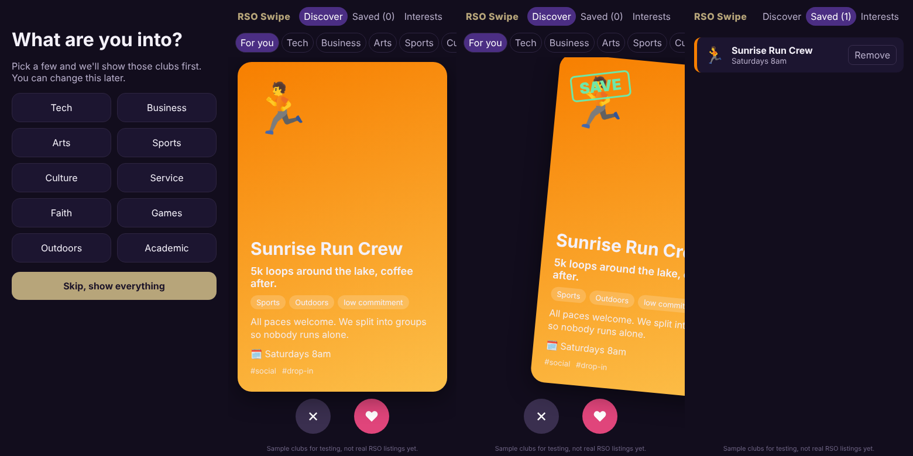

# RSO Swipe

UW has hundreds of RSOs (registered student organizations) and the only way
to find them is scrolling a giant directory or walking around the club fair.
I wanted something that feels more like scrolling reels: one club per screen,
swipe right if it looks interesting, left if not, and keep a list of the ones
you saved.

**Status: in development.** The clubs in the app right now are sample data I
made up for testing, not real RSOs. Next step is getting real club info in.



## What it does

- pick your interests first (Tech, Arts, Faith, Sports, ...) and matching
  clubs show up first
- scroll up and down through clubs like reels
- drag a card right to save it, left to skip it (or use the buttons, or the
  arrow keys on a laptop)
- filter by category
- saved clubs list with meeting times
- remembers your interests and swipes in the browser (localStorage), so no
  account needed

## How the feed is ranked

`src/lib/deck.js` has all the logic, kept out of the React components so I
could test it on its own:

- +3 for every category that matches your interests
- +1 for low commitment clubs (I'd rather people try something easy first)
- clubs with no matching interest go to the bottom
- anything you already saved or skipped is hidden, and there's a button to
  bring skipped clubs back

## Running it

```
npm install
npm run dev     # local dev server
npm test        # vitest, 18 tests for the ranking/swipe/storage logic
npm run build
```

GitHub Actions runs the tests and the build on every push, and deploys the
`main` branch to GitHub Pages.

## Stack

React 19, Vite, plain CSS (scroll-snap for the reels, pointer events for the
swipe), Vitest.

## Next

- replace `src/data/clubs.js` with real RSO data (want to ask clubs to fill a
  short form instead of scraping)
- a backend so saves sync across devices and clubs can see interest
- "people who saved X also saved Y" recommendations once there's real usage
- get it in front of actual freshmen before the next club fair
